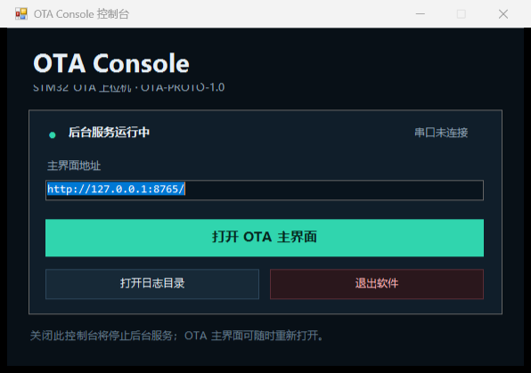

# OTA Console

基于 Python + 原生 HTML 的 STM32 OTA 上位机，实现 `OTA-PROTO-1.0` 串口通讯协议。



## 功能

- 串口扫描与连接：115200、8 数据位、无校验、1 停止位。
- 固定 16 字节协议帧，STM32F1 硬件 CRC（`0x04C11DB7 / 0xFFFFFFFF / xorout=0`）。
- 流式收帧：支持 UART 拆包、粘包和 `0xA5` 自动重新同步。
- `GetCRC`、`GetMID`、`GetSta` 查询事务。
- 固件 `.bin` 装载、15 个程序页 CRC 计算、不足 15 KB 自动以 `0xFF` 补齐。
- 运行区 CRC 对比，只写入 CRC 不一致的程序页。
- 1 KB 控制页生成与 Page16 自身 CRC 计算。
- 每帧 500 ms 停等确认，最多重发 5 次；Number 与 CRC 同时匹配才推进。
- 最终 `SetMID`、16 帧 `SetCRC`、`SetSta`、`SetEnd` 握手及目标页 CRC 复核。
- HTML 实时界面：设备状态、固件校验、总进度、16 行页明细、TX/RX 日志。
- SSE 实时推送；界面不依赖任何 CDN，离线可用。
- 运行日志自动写入 `logs/runtime/ota-YYYY-MM-DD.log`。

## 快速启动

双击：

```text
start.bat
```

脚本会自动创建 `.venv`、安装运行依赖，启动 Python 桌面控制台，并自动打开 HTML 主界面。也可以手动执行：

```powershell
python -m venv .venv
.\.venv\Scripts\python.exe -m pip install -r requirements.txt
.\.venv\Scripts\python.exe -m ota_host
```

默认地址：<http://127.0.0.1:8765/>

默认启动 Python 桌面控制台；主界面使用系统浏览器承载，关闭控制台会停止后台服务。常用参数：

```powershell
.\.venv\Scripts\python.exe -m ota_host --desktop
.\.venv\Scripts\python.exe -m ota_host --browser
.\.venv\Scripts\python.exe -m ota_host --no-browser
.\.venv\Scripts\python.exe -m ota_host --port 9000
```

## 使用流程

1. 刷新并选择串口，点击“连接串口”。
2. 选择 `.bin` 固件，确认大小、整体 CRC 和 15 个页 CRC。
3. 填写目标程序 ID（`0x0001~0xFFFF`）。
4. 可先执行“查询 CRC / 查询状态 / 查询 ID”确认链路。
5. 点击“开始 OTA 升级”，在确认框中确认。
6. 观察页级明细和实时日志；只有收到匹配 `AckCRC` 的帧才推进进度。
7. 最终状态为 `VALID_BACKUP` 且目标页 CRC 全部一致，界面才显示升级成功。

## 协议实现要点

### 帧格式

```text
A5 | Type(6 ASCII) | Number(1) | Data(4) | CRC32(4)
```

- 所有多字节整数均使用小端。
- CRC 输入为帧字节 `0..11` 组成的 3 个小端 `uint32_t`。
- `AckCRC` 本身不回复确认。
- 业务帧确认要求 `Type=AckCRC`、`Number` 相同、`Data` 等于原帧 CRC 原值。

### 页模型

- Page 0~14：15 个程序页，每页 1 KB，共 15 KB。
- Control：偏移 `0x3C00`，1 KB 控制页。
- 控制页前 132 字节为字段，其余全 `0xFF`。
- Page16.CRC 计算前先把偏移 `128..131` 置 0，再对完整 1 KB 计算硬件 CRC。

### 最终握手

上位机发送 `SetEnd` 后，设备成功回报顺序：

```text
SetMID
SetCRC #00 ... SetCRC #0F
SetSta  (0x05 / FF / FF / 00)
SetEnd  (0x05 / FF / FF / 00)
```

上位机逐帧回复 `AckCRC`，并复核 15 个程序页最终 CRC 与本地固件一致。

## 项目结构

```text
doc/                       原始上位机/设备协议文档
docs/UI-PLAN.md            HTML 界面规划
docs/ui-wireframe.html     静态界面线框图
ota_host/protocol.py       帧、CRC、解析器、控制页
ota_host/serial_link.py    串口接收线程
ota_host/engine.py         查询与升级状态机
ota_host/web_server.py     本地 HTTP/SSE 服务
ota_host/desktop.py        Python 桌面控制台与服务生命周期
ota_host/event_bus.py      SSE 事件分发
web/index.html             页面结构
web/styles.css             视觉样式
web/app.js                 页面交互与实时渲染
tests/                     协议层与状态机测试
logs/conversations/        对话和决策日志
logs/runtime/              运行日志与测试日志
```

## 测试

```powershell
.\.venv\Scripts\python.exe -m unittest discover -s tests -v
```

或双击 `run_tests.bat`。

测试覆盖：

- 文档中的 10 组完整帧 CRC 示例。
- ACK 的 Number 与 CRC 回显。
- UART 拆包、粘包、错误帧重新同步。
- 控制页布局与 Page16 CRC。
- 页 CRC 比较与待写页决策；差异页在控制页中的 CRC 初始填 0。
- 假设备下的 CRC/ID/状态查询。
- 每次升级强制重新 `GetCRC` 后才允许发送 `SetDat`。
- 全页相同、仅部分页不同的升级流程。

## 日志规则

- 每个对话轮次记录到 `logs/conversations/YYYY-MM-DD.md`。
- 遇到问题先检索对话日志和运行日志。
- 串口 TX/RX、任务阶段、错误和最终结果写入 `logs/runtime/ota-YYYY-MM-DD.log`。
- 界面日志保存在内存中，最多 2000 条，可下载为文本。

## 当前边界

- 已通过协议与假设备测试；尚未连接真实 STM32 设备进行 115200 串口联调。
- 桌面控制台使用 Python.NET/WinForms，主界面仍为原生 HTML/CSS/JavaScript。
- 设备端必须实现协议规定的 16 字节流式收帧、业务 ACK、选槽、页写和最终握手。
- 实际烧录前应先执行查询并核对设备返回的运行区 CRC、程序 ID 与目标槽规则。

