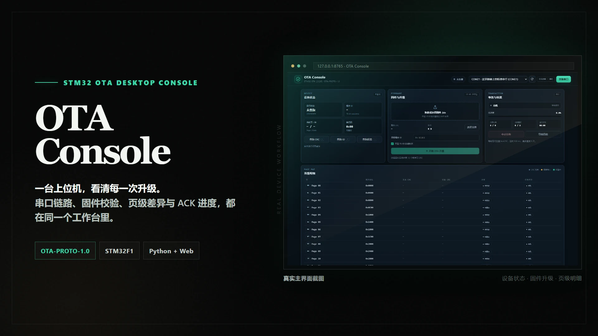
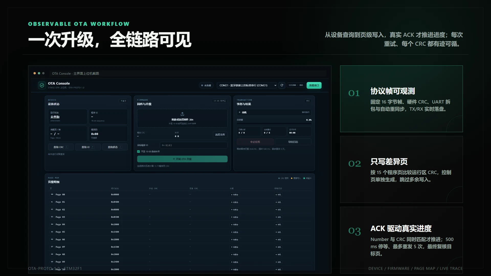

<div align="center">

# OTA Console

**把 STM32 OTA 升级从“发完等结果”变成一条可观察、可校验、可追溯的链路。**



[](https://www.python.org/)
[](doc/上位机/01-通讯协议完整规范.md)
[](start.bat)

</div>

---

## 这是什么

OTA Console 是面向 STM32F1 BootLoader 的桌面 OTA 上位机。它把串口链路、固件页校验、差异页写入、逐帧 ACK 和最终 CRC 复核集中在一个界面里，让操作人员随时知道设备当前状态、任务进度和失败原因。

项目采用 **Python 本地服务 + 原生 HTML/CSS/JavaScript + SSE**，不依赖云端，也不依赖 CDN。双击启动后即可在离线工控环境中使用。

## 为什么需要它

OTA 的风险不只在“固件有没有发出去”，更在于发送过程是否真的被设备确认、写入了哪些页、最终运行区是否完整。

OTA Console 遵循 `OTA-PROTO-1.0`：

- 固定 **16 字节协议帧**，使用 STM32F1 硬件 CRC。
- 收帧支持 UART 拆包、粘包和 `0xA5` 自动重同步。
- 升级前查询运行区 CRC，只写入 CRC 不一致的程序页。
- 每一帧都等待匹配的 `AckCRC`，Number 与 CRC 同时一致才推进。
- 最终完成 `SetMID`、16 帧 `SetCRC`、`SetSta`、`SetEnd` 握手并复核目标页。
- TX/RX、事务阶段、错误和结果同步显示并写入本地运行日志。

## 你会得到什么



一个界面即可完成设备查询、固件装载、页差异比较、OTA 写入、失败定位和日志导出。升级进度只由真实 ACK 推进，不使用模拟动画掩盖链路状态。

## 设备端开源

设备端 BootLoader 工程与协议实现维护在独立仓库：

- [STM32-F103C8T6-BootLoader-OTA](https://github.com/aguozimu/STM32-F103C8T6-BootLoader-OTA.git)

## 快速开始

### Windows 一键启动

双击 `start.bat`。脚本会自动创建 `.venv`、安装依赖、启动桌面控制台，并打开 OTA 主界面。

### 手动启动

```powershell
python -m venv .venv
.\.venv\Scripts\python.exe -m pip install -r requirements.txt
.\.venv\Scripts\python.exe -m ota_host
```

默认地址：<http://127.0.0.1:8765/>

常用运行模式：

```powershell
# 默认：Python 桌面控制台 + 系统浏览器主界面
.\.venv\Scripts\python.exe -m ota_host

# 直接使用系统浏览器
.\.venv\Scripts\python.exe -m ota_host --browser

# 仅启动本地服务，不打开界面
.\.venv\Scripts\python.exe -m ota_host --no-browser

# 自定义端口
.\.venv\Scripts\python.exe -m ota_host --port 9000
```

## 使用流程

1. 刷新并选择串口，以 `115200 · 8N1` 连接设备。
2. 选择 `.bin` 固件，检查大小、整体 CRC 和 15 个程序页 CRC。
3. 填写 `0x0001~0xFFFF` 范围内的目标程序 ID。
4. 执行查询 CRC / 查询 ID / 查询状态，确认链路与设备状态。
5. 点击“开始 OTA 升级”，观察页级明细、总进度和实时日志。
6. 仅当状态为 `VALID_BACKUP` 且目标页 CRC 全部一致时，升级才判定成功。

## 工作方式

```text
连接串口
  → 查询设备运行区 CRC / 程序 ID / 状态
  → 比较 15 个程序页，生成差异页与控制页
  → 发送控制页与差异页，逐帧等待 AckCRC
  → 执行最终握手
  → 复核目标页 CRC
```

### 帧格式

```text
A5 | Type(6 ASCII) | Number(1) | Data(4) | CRC32(4)
```

- 多字节整数使用小端。
- CRC 输入为帧字节 `0..11` 组成的 3 个小端 `uint32_t`。
- `AckCRC` 本身不回复确认。
- 业务帧确认要求 `Type=AckCRC`、`Number` 相同、`Data` 等于原帧 CRC。

### 页模型

- Page 0~14：15 个程序页，每页 1 KB。
- Control：偏移 `0x3C00`，独立 1 KB 控制页。
- 不足 15 KB 的固件自动以 `0xFF` 补齐。
- Page16 CRC 计算前将偏移 `128..131` 置 0，再计算完整 1 KB。

## 测试

```powershell
.\.venv\Scripts\python.exe -m unittest discover -s tests -v
```

当前自动化测试覆盖协议帧 CRC、ACK 回显、UART 拆包/粘包、控制页布局、页差异决策、查询事务、重试、部分页升级、全页相同升级和最终 CRC 失败等场景。

## 文档

- [上位机通讯协议完整规范](doc/上位机/01-通讯协议完整规范.md)
- [设备通讯协议完整规范](doc/设备/01-通讯协议完整规范.md)
- [UI 设计与实现规划](docs/UI-PLAN.md)

## 当前边界

- 自动化测试使用假设备覆盖协议与状态机；现场烧录前仍应核对真实设备返回的运行区 CRC、程序 ID 和目标槽规则。
- 设备端必须实现协议规定的流式收帧、业务 ACK、选槽、页写与最终握手。
- 本工具只作为 OTA 上位机，不修改设备固件。
- 服务默认仅监听 `127.0.0.1`，运行日志保存在 `logs/runtime/`。

<div align="center">

**Built for observable firmware delivery.**

</div>